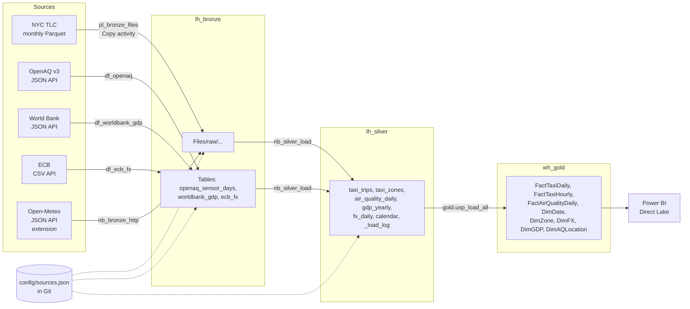

# NYC Urban Analytics on Microsoft Fabric

A unified analytics platform that combines **urban mobility** (NYC TLC taxi trips), **air quality**
(OpenAQ PM2.5 / NO2) and **economy** (World Bank GDP, ECB USD/EUR) in a Microsoft Fabric
lakehouse + warehouse with a medallion architecture (Bronze → Silver → Gold).



## Key ideas

* **Configuration-driven and extensible.** Every dataset is one entry in [`config/sources.json`](config/sources.json):
  how it is ingested, where it lands, which transform builds its silver table and how it is written.
  A dataset with a known shape (e.g. green taxi) is added by configuration only; a new shape needs one
  transform function. Gold loads are listed in `meta.GoldLoads`. See [docs/05_adding_a_source.md](docs/05_adding_a_source.md).
* **Git is the single source of truth.** The workspace is connected to this repository (Fabric Git integration,
  folder `workspace/`); notebooks, pipelines, dataflows and the warehouse are versioned. Pipelines and dataflows
  read the configuration directly from Git.
* **Idempotent, incremental loads.** Bronze copies only missing months; silver processes only new/changed files
  (`_load_log`) and replaces whole partitions; gold procedures rebuild their tables.
* **Data quality built in.** Schema drift between monthly files is handled, invalid rows are counted per reason,
  duplicates removed, units standardised; every load is logged (rows in / out / rejected).

## Repository layout

| path | content |
|---|---|
| `config/sources.json` | registry of all data sources (the extension point) |
| `src/notebooks/` | PySpark notebooks (authoring copy, unit-tested) |
| `src/dataflows/` | Power Query M of the three Dataflows Gen2 |
| `src/warehouse/` | T-SQL: star schema, load procedures, analytical views |
| `workspace/` | Fabric workspace items, synced by Fabric Git integration |
| `tests/` | local Spark tests of the silver transformations (run in GitHub Actions) |
| `tools/` | `build_notebooks.py` (py → ipynb for import) |
| `docs/` | setup, architecture, data dictionary, governance, extension guide, dashboards |

## Documentation

1. [Setup in Fabric](docs/01_setup.md)
2. [Architecture and lineage](docs/02_architecture.md)
3. [Data dictionary](docs/03_data_dictionary.md)
4. [Governance policies](docs/04_governance.md)
5. [Adding a data source](docs/05_adding_a_source.md)
6. [Dashboards](docs/06_dashboards.md)

## Local tests

```bash
pip install -r requirements-dev.txt      # needs Java 17
cd tests && python -m pytest -q
```
