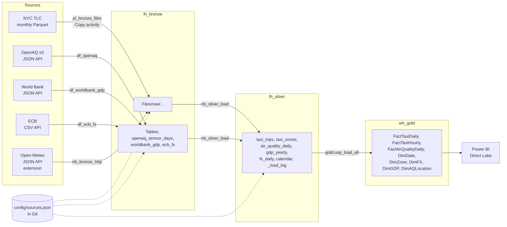
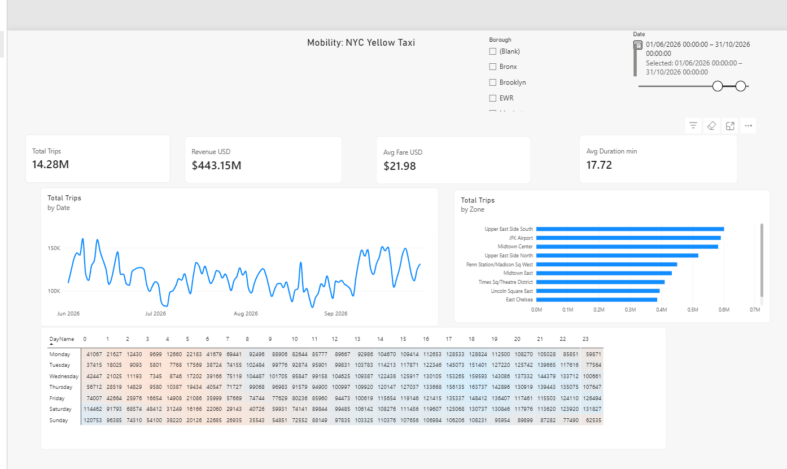
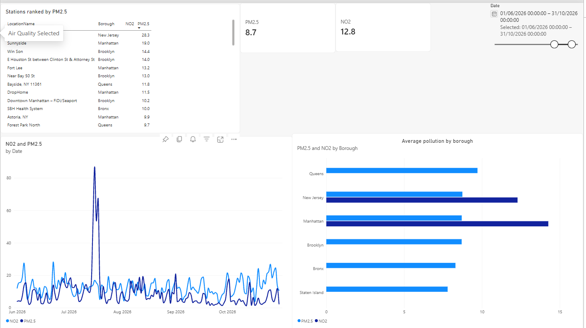
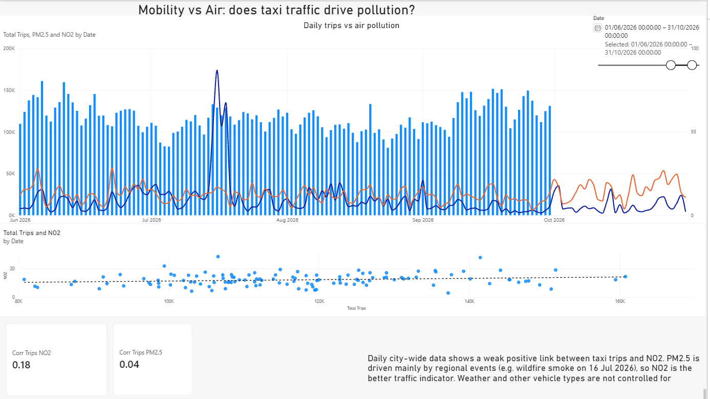
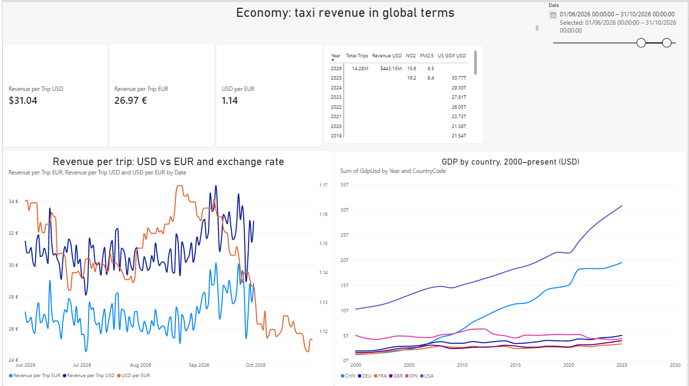
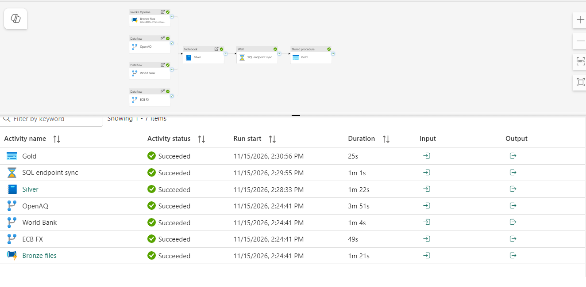
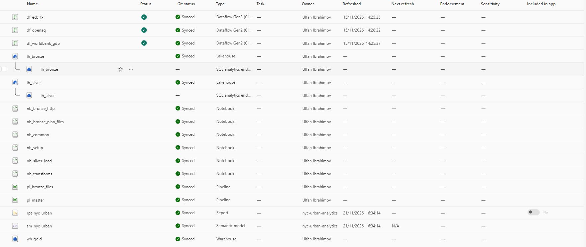

# NYC Urban Analytics on Microsoft Fabric

A unified analytics platform that combines **urban mobility** (NYC TLC taxi trips), **air quality**
(OpenAQ PM2.5 / NO2) and **economy** (World Bank GDP, ECB USD/EUR) in a Microsoft Fabric
lakehouse + warehouse with a medallion architecture (Bronze → Silver → Gold).



## Key ideas

* **Configuration-driven and extensible.** Every dataset is one entry in [`config/sources.json`](config/sources.json):
  how it is ingested, where it lands, which transform builds its silver table and how it is written.
  A dataset with a known shape (e.g. green taxi) is added by configuration only; a new shape needs one
  transform function. Gold loads are listed in `meta.GoldLoads`. See [docs/05_adding_a_source.md](docs/05_adding_a_source.md).
* **Git is the single source of truth.** The workspace is connected to this repository through Fabric Git
  integration (Azure DevOps, mirrored to GitHub; folder `workspace/`); notebooks, pipelines, dataflows, the
  warehouse, the semantic model and the report are versioned. Notebooks and dataflows read the configuration
  directly from Git.
* **Idempotent, incremental loads.** Bronze copies only missing months; silver processes only new/changed files
  (`_load_log`) and replaces whole partitions; gold procedures rebuild their tables.
* **Data quality built in.** Schema drift between monthly files is handled, invalid rows are counted per reason,
  duplicates removed, units standardised; every load is logged (rows in / out / rejected).

## Results

The Fabric workspace lives in a university tenant and is not public, so the results are shown here.
Full report export: [docs/report/rpt_nyc_urban.pdf](docs/report/rpt_nyc_urban.pdf).

| | |
|---|---|
| Yellow taxi trips (Jun-Oct 2026) | 14.58 M loaded, 14.28 M after cleaning (1.7 % rejected, 58 k duplicates) |
| Air quality | 22,645 station-days from 55 OpenAQ stations |
| Gold star schema | 5 dimensions, 3 facts, 8 load procedures |
| Full pipeline run | about 7 minutes, four sources in parallel |

| question | answer |
|---|---|
| Q1 Do taxi trips relate to air quality? | Very weakly: daily correlation of trips with NO2 is r = 0.18, with PM2.5 r = 0.04. |
| Q2 Which zones and times? | Demand peaks on weekday afternoons and evenings, in Upper East Side, Midtown and at JFK. Air quality is daily, so hours cannot be linked directly. |
| Q3 Revenue per trip USD vs EUR? | $31.04 vs €26.97; the EUR value moves with the ECB rate (about 1.11-1.17 USD per EUR in Jun-Oct 2026). |
| Q4 Multi-year growth vs environment? | US GDP grew from about $10 T (2000) to $30.8 T (2025); taxi history currently starts in Jun 2026 (one date in the configuration). |

On 16 Jul 2026 PM2.5 rose to 86.8 µg/m³ while NO2 stayed normal: smoke from Canadian wildfires, not traffic.
Details and limitations: [docs/06_dashboards.md](docs/06_dashboards.md).

**Mobility**


**Air Quality**


**Mobility vs Air**


**Economy**


**Orchestration** - a successful `pl_master` run


**Source control** - every workspace item synced with Git


## Repository layout

| path | content |
|---|---|
| `config/sources.json` | registry of all data sources (the extension point) |
| `src/notebooks/` | PySpark notebooks (authoring copy, unit-tested) |
| `src/dataflows/` | Power Query M of the three Dataflows Gen2 |
| `src/warehouse/` | T-SQL: star schema, load procedures, analytical views |
| `workspace/` | Fabric workspace items, synced by Fabric Git integration |
| `tests/` | local Spark tests of the silver transformations (run in GitHub Actions) |
| `tools/` | `build_notebooks.py` (py → ipynb for import) |
| `docs/` | setup, architecture, data dictionary, governance, extension guide, dashboards |

## Documentation

1. [Setup in Fabric](docs/01_setup.md)
2. [Architecture and lineage](docs/02_architecture.md)
3. [Data dictionary](docs/03_data_dictionary.md)
4. [Governance policies](docs/04_governance.md)
5. [Adding a data source](docs/05_adding_a_source.md)
6. [Dashboards](docs/06_dashboards.md)

## Local tests

```bash
pip install -r requirements-dev.txt      # needs Java 17
cd tests && python -m pytest -q
```
