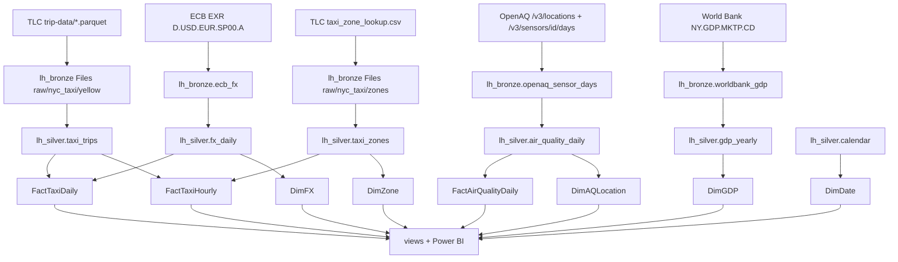

# 2. Architecture and lineage

## Layers

| layer | store | content | written by |
|---|---|---|---|
| **Bronze** (raw) | `lh_bronze` Files | taxi Parquet files, zone CSV, weather JSON - unchanged copies, partitioned `year=/month=` | `pl_bronze_files` (Copy), `nb_bronze_http` |
| | `lh_bronze` Tables | `openaq_sensor_days`, `worldbank_gdp`, `ecb_fx` - API JSON/CSV flattened to tables, all columns as delivered + `ingested_at` | Dataflows Gen2 |
| **Silver** (clean) | `lh_silver` Delta tables | typed, de-duplicated, standardised, enriched with date parts; `_load_log`; `calendar` | `nb_silver_load` + `nb_transforms` |
| **Gold** (model) | `wh_gold` Warehouse | star schema (facts by day), analytical views, load metadata | `gold.usp_load_all` |
| Consumption | Power BI semantic model (Direct Lake on `wh_gold`) | four report pages | - |

## Lineage

Fabric's own lineage view (workspace > Lineage) shows the same item-level graph; Purview (optional) adds column level.

## Orchestration

`pl_master` (daily 06:00): bronze files ∥ three dataflows → silver notebook → wait → gold procedure → semantic model refresh.
Every step is idempotent, so a failed run is simply re-run.

## Design decisions

| decision | why |
|---|---|
| One configuration file in Git read at run time by notebooks **and** dataflows | single source of truth; adding/changing a source is a reviewed commit, not a UI change in several places |
| Pipeline plans its own work (`nb_bronze_plan_files` → ForEach Copy) | metadata-driven: new file datasets need no pipeline change; only missing months are copied |
| Bronze keeps raw files unchanged | re-processing is always possible, audit trail |
| Each monthly taxi file is read alone and conformed to one schema | TLC changed column names/types over time (`Airport_fee`/`airport_fee`, int/double, `cbd_congestion_fee` from 2025) |
| `_load_log` with bronze file + modification time | incremental: only new or re-downloaded files are processed; monitoring of rejected rows |
| `replace_partition` (taxi), `merge` (air quality, weather), `overwrite` (small reference data) | idempotent loads matching the change pattern of each source |
| FX forward-filled to every calendar day, flag `is_published` | ECB has no rates on weekends/holidays; taxi revenue exists every day |
| Units standardised in silver (NO2 → ppb) | OpenAQ sensors report NO2 in ppm or µg/m³ |
| Gold in Warehouse, loads listed in `meta.GoldLoads` | T-SQL star schema for BI; new facts are added by registration, the orchestrating procedure stays unchanged |
| Secrets only in `lh_bronze.cfg_secrets` (restricted) | no keys in Git; production: Azure Key Vault |
